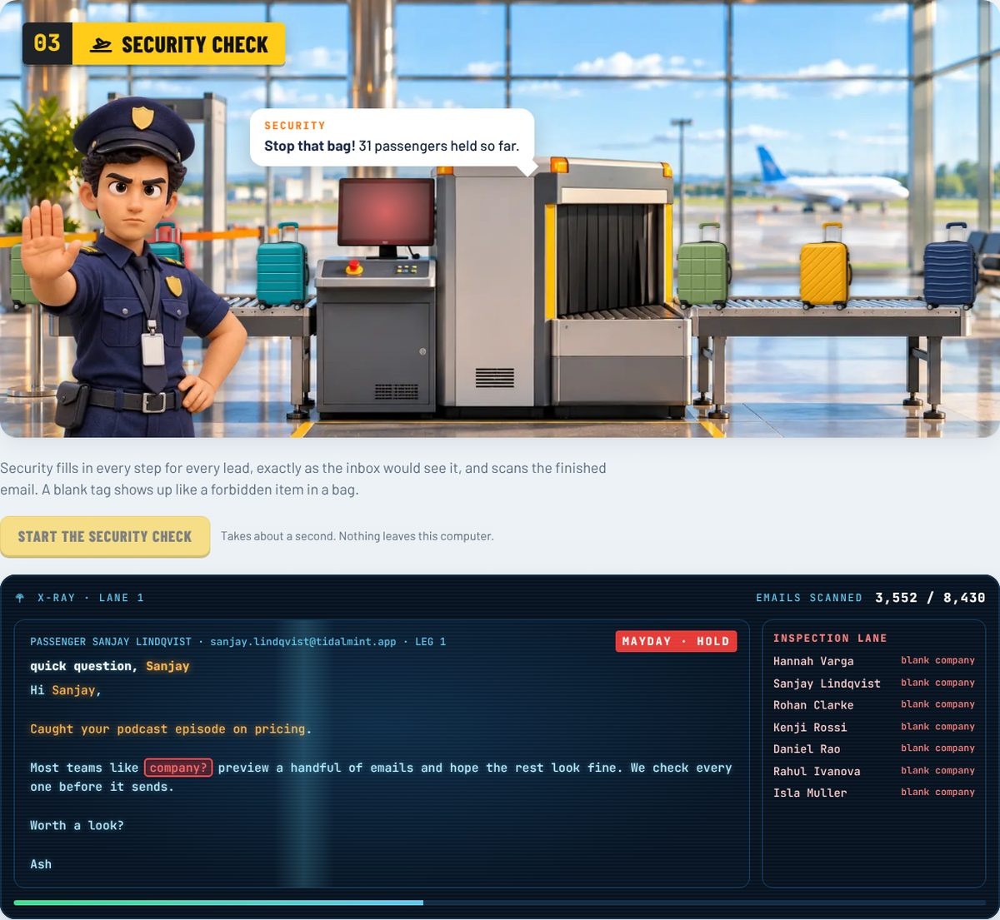

# ✈️ Ground Crew

**The pre-flight check for outbound. No signal needed.**


You load 3,000 leads into a sequence.
You preview the first 20. They look fine.
The other 2,980? You hope for the best.

Then someone gets `Hi {{first_name}},`
Priya gets the same email twice.
A CEO reads "Loved what is doing."

Ground Crew catches all of it before you send, and helps you fix it.
**Check every email. Upload nothing.**
It checks **every email, for every lead, across every step**.
On your laptop. With the Wi-Fi off.

> Built for Hackyard Yard #6 · theme: **Offline**
>
> 🎬 Demo video: *coming soon*

---

## Why it runs offline

Your lead list is your clients' data.
Most tools that can check every email want you to upload it first, and then charge per check.
Ground Crew checks it where it already is: on your laptop.

- **🔒 Private by design.** Not one row is uploaded. The page itself blocks the internet, so it couldn't send anything if it tried.
- **∞ No credits, no limits.** No sign-up, no per-email pricing. 50,000 leads are checked in about 2 seconds.
- **✈ Works on the plane.** Prep Monday's campaign on the flight, on bad café Wi-Fi, or when the internet is down.
  Turn your Wi-Fi off mid-check and the light switches to **✈ AIRPLANE MODE**. The Marshal doesn't mind.

The stakes are simple: one broken tag × 3,000 sends = 3,000 people who now think you're a bot.
A sent email can't be recalled.

---

## Try it

**Online:** [raoashwini21.github.io/ground-crew](https://raoashwini21.github.io/ground-crew/)
Once the page has loaded, turn your Wi-Fi off. It keeps working, because it never needed the network.

**Offline, for real:**
1. Download **[`Ground Crew.html`](dist/Ground%20Crew.html)**
2. Turn your Wi-Fi off
3. Double-click the file
4. Click **Try it with Skyline Leads** (3,000 made-up leads with planted problems), or drop in a file from [`test-kit/`](test-kit/)

No install. No npm. No server. No account.
One file, about 1.7 MB, with all the art, fonts and sounds inside.

---

## What happens at each station

| Station | What it does |
|---|---|
| **00 Check-in** | Drop in a CSV from Apollo, Clay, Sales Navigator or any sheet. Ground Crew guesses which column is which, and you confirm. |
| **01 Baggage Claim** | Fixes messy fields, merges twins, and holds rows that can't be emailed. Every fix shows what it was before. |
| **02 Control Tower** | Each email step is a flight strip. The tower radios in as you type: broken tags, blanks with no fallback, spammy words, long sentences. |
| **03 Boarding Gate** | Security Check fills in every step for every lead and scans the finished email. Any Mayday holds that lead. |
| **04 Take-off** | Download the clean leads, the held leads with reasons, and a log of every change. Nothing is sent. |





---

## Fix it where you find it

Finding problems is half the job. Every Mayday at the gate comes with a fix, and each fix re-scans straight away:

| Problem | One-click fix |
|---|---|
| `{{company}}` blank for 80 leads | Add a fallback (`{{company\|your team}}`), or type the missing values in |
| `{{frist_name}}` isn't a column | Change it to `{{first_name}}` in every leg |
| `Hi JOHN` | Fix the capitals for those leads |
| No name or bad email (Lost & Found) | Type it into the row and re-check |

Your original file is never changed.
Everything you type is logged in `changes.csv` as *edited by you*.

---

## What it catches

**Held at the gate (Mayday)**
- A tag that isn't a column: `{{frist_name}}` → *Did you mean `{{first_name}}`?*
- A tag that comes out blank, with no fallback: `Hi ,`
- Broken braces: `{first_name}}`
- Names still in capitals: `Hi JOHN`

**Boards, but flagged (Turbulence)**
- A "personal" line copied across hundreds of leads
- A sentence or subject that gets too long once the company name is filled in
- Leftover legal endings: `saw Acme Inc., LLC is hiring`
- Shared inboxes like `info@` and `sales@`
- Messy spacing and punctuation

**Fixed in Baggage Claim**
- `"  JOHN "` → `John`, `Dr. Priya` → `Priya`
- `ACME CORP` → `Acme Corp` (but `IBM` stays `IBM`)
- `Brightwave Pvt Ltd` → `Brightwave`
- `VP Sales | Ex-Google | Speaker` → `VP Sales`
- Same email or same LinkedIn profile → merged into one lead

**Sent to Lost & Found**
- No first name, or junk like `Test`, `N/A`, `J.`
- No email, or one that isn't shaped like an email

---

## Offline, for real

The file carries its own security policy:

```
default-src 'none'; connect-src 'none'; script-src 'sha256-…'
```

That means the page **cannot** make a network request, even by accident.
No CDN, no analytics, no fonts from the web, no AI API.
Fonts, styles and code are all inside the one file.

The **Radio Silence** light in the corner reads that lock, and counts any request the page tries.
It stays at `0 TX`.

Even the sounds are made live in the browser (the ding-dong, the radio, the X-ray beep, the jet), so there are no audio files to fetch.

---

## Your data stays yours

- Your original file is never changed
- Lead lists are never saved in the browser
- **Sweep the hangar** clears everything from the page
- Every cell is treated as plain text, never code
- Exports neutralise any cell starting with `=`, `+`, `-` or `@`, so nothing can run as a formula in Excel or Sheets

---

## What it deliberately doesn't do

- Find, scrape or enrich leads
- Send emails or schedule campaigns
- Verify inboxes or promise deliverability
- Use an AI model

It's rules and matching, so it's instant and gives the same answer every time.
The Control Tower's score is a writing guide, not a prediction of replies.

---

## Speed

Measured on a normal laptop, no internet:

| Leads | Emails checked | Time |
|---|---|---|
| 3,000 | 8,430 | ~0.4 s |
| 10,000 | 28,095 | ~1 s |
| 50,000 | 140,433 | ~5 s |

In the page, a 50,000-row file loads in about 1.3 s and is scanned in about 2 s, without freezing.

---

## Build it yourself

```bash
npm install
npm test        # 32 tests: every planted problem caught, look-alikes left alone
npm run build   # → dist/Ground Crew.html
npm run skyline # → data/skyline-leads.csv
```

The code lives in normal files under `src/`.
`npm run build` bundles everything into the single HTML file.

---

## Test kit

[`test-kit/`](test-kit/) has small files that try to break it:
semicolon CSVs from European Excel, accents and non-Latin names, a full-name-only column, Apollo-style headers,
quotes and line breaks inside cells, an empty file, a header-only file, no email column,
formula cells, messy rows, HTML in cells, and a tab-separated file.

---

## Skyline Leads

A made-up list of 3,000 people at made-up companies.
Problems are planted on purpose: twins, shouting names, missing companies, junk rows, formula cells.
Every person and company in it is invented.

---

MIT licence · Fonts: Barlow and JetBrains Mono (SIL Open Font License)
Art: scenes and crew generated for this project during Hackyard build week, cleaned and packed by `tools/art.py`.
